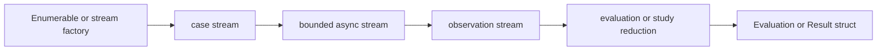
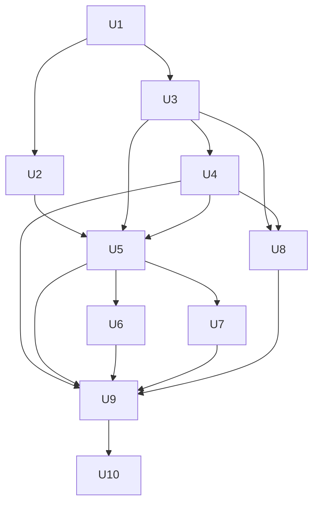

# Consolidate evaluation and search behind the Tune pipeline

## Goal Capsule

- **Objective:** Make Tune one simple Elixir package for structured LLM programs,
  evaluation, prompt optimization, and generic search. Use the best proven
  behavior from `jido_eval` and `jido_evolve` without preserving their APIs.
- **Means:** Refactor Tune in place. Replace the old facade with one immutable
  lazy pipeline, retain useful engines behind internal boundaries, and add
  selected evaluation and genetic-search behavior as Tune-native code.
- **Authority:** Implement local Tune code and documentation only when later
  requested. Commits, pushes, publication, and changes to other packages require
  separate authority.
- **Stop conditions:** Stop if the new facade needs more than twelve top-level
  workflow functions, if the implementation adds a compatibility layer, or if
  source transfer creates an unresolved license or attribution issue.
- **Next executor:** An Elixir package maintainer working in the unit dependency
  order below.

## Product Contract

### Summary

Tune sits above ReqLLM and beside Elixir numerical tools. It describes what can
change, how results are measured, how candidates are searched, and which result
wins. `Tune.new/2` creates an immutable `%Tune{}` pipeline. Pipeline-building
calls only add data. A terminal call validates and executes the description.

The same pipeline supports three uses:

1. Evaluate an LLM program or application function.
2. Tune a structured LLM program with DSPy-style prompt and example strategies.
3. Search any declared Elixir value space with a generic strategy such as a
   genetic algorithm, including configuration used by Nx or Axon applications.

### Problem Frame

The current Tune package has strong LLM program and optimizer internals, but its
top-level API exposes separate eager `run/3`, `evaluate/3`, and `optimize/2`
operations. `jido_eval` separately owns datasets, metrics, judges, statistics,
and an OTP evaluation harness. `jido_evolve` separately owns a generic genetic
search engine. A developer must learn three public models and write application
glue between them.

Tune needs one clear spine. It must remain useful for a small structured prompt,
a full agent evaluation, and a non-LLM search without becoming an agent runtime,
workflow engine, provider client, or general machine-learning framework.

### Actors

- **Elixir application developer:** Defines a target, data, scores, search, and
  limits through one pipeline.
- **LLM program author:** Inspects structured prompts and tunes instructions,
  demonstrations, rules, or declared values for fixed model configurations.
- **Jido application:** Uses Tune as an independent library for agent evaluation
  and tuning. Jido remains optional.
- **Package maintainer:** Adds score, variation-space, or search implementations
  through small extension contracts without adding top-level workflow functions.

### Requirements

| ID | Requirement |
| --- | --- |
| R1 | Expose one lazy, immutable `%Tune{}` pipeline as the primary workflow. `Tune.new/2` is the only structured entry point. Pipeline-building calls do no model calls, task starts, file writes, or search work. |
| R2 | Limit the top-level workflow facade to twelve function names: `new`, `data`, `vary`, `score`, `select`, `search`, `limit`, `preview`, `evaluate`, `tune`, `dump`, and `load`. |
| R3 | Support structured LLM programs on ReqLLM. Preserve typed signatures, Chat/JSON/XML adapters, prompt inspection, target/teacher/proposal model roles, and all current DSPy-style optimizers. |
| R4 | Support generic Elixir targets and search spaces without a language model, Jido, or Python. Remain compatible with Nx tensors, Axon models, Axon loops, and stream-based training data without requiring Nx or Axon at runtime. |
| R5 | Let repeated `Tune.score` calls append unique named scores. Keep measurement separate from selection. Require an explicit selection rule when more than one score can choose a winner. |
| R6 | Evaluate enumerable data with retained row errors, optional failure scores, named score results, aggregate statistics, and optional structured ReqLLM judges. |
| R7 | Use explicit limits for model calls, evaluations, concurrency, row timeout, and total deadline as applicable. Continue safe work after row failures and return the best fully evaluated eligible candidate with a stop reason. |
| R8 | Provide a common search contract for LLM-aware and model-agnostic strategies. Include the current fifteen Tune optimizer targets and the useful genetic search behavior from `jido_evolve`. |
| R9 | Return immutable results and one clean learned-parameter artifact format. Artifacts contain learned JSON-compatible values and safe provenance. They do not contain code, functions, credentials, model runtime configuration, or response structs. |
| R10 | Keep boundaries strict: ReqLLM owns provider transport and retries; Tune owns programs, scores, evaluation, search, selection, and artifacts; the application owns tools, agent loops, side effects, persistence, credentials, and deployment. |
| R11 | Keep Tune independent of `jido_eval` and `jido_evolve`. Reimplement selected behavior with Tune-native types. Do not add compatibility aliases, adapters for old public APIs, or migration shims. |
| R12 | Prove the complete API offline with a structured two-step LLM example and a non-LLM genetic-search example. The LLM example must compose at least two named scores and show the rendered optimized prompt. |
| R13 | Define stable public structs for pipeline, prediction, observation, evaluation, result, score summary, and artifact values. Use Zoi at public map and artifact boundaries. Extension callbacks receive and return these documented values or normalized tagged tuples. |
| R14 | Use Enumerables and streams for data intake, bounded concurrent evaluation, candidate generation, and internal event reduction. `Tune.evaluate/1` and `Tune.tune/1` remain eager terminal operations that consume each internal stream once. |
| R15 | Prove Nx and Axon compatibility in a test-only consumer. Nx tensors and Axon values can pass through runners and result metadata as opaque terms. Only JSON-compatible learned parameters and provenance can enter Tune artifacts. |

### Key Flows

#### Structured LLM tuning

```elixir
Tune.new(program, model: target, teacher: teacher)
|> Tune.data(train: train, validation: validation)
|> Tune.score(:answer, &answer_score/2)
|> Tune.score(:citations, &citation_score/2)
|> Tune.select(weighted: [answer: 0.8, citations: 0.2])
|> Tune.search(:bootstrap_few_shot,
  num_candidates: 8,
  max_demos: 4
)
|> Tune.limit(model_calls: 500)
|> Tune.tune()
```

#### Evaluation without search

```elixir
Tune.new(agent, run: &CodingAgent.run/2)
|> Tune.data(test: coding_tasks)
|> Tune.score(:correctness, &CodingScore.score/2)
|> Tune.evaluate()
```

#### Generic genetic search

```elixir
Tune.new(%{batch_size: 10, threshold: 0.5}, run: &Benchmark.run/1)
|> Tune.vary(
  batch_size: 1..100,
  threshold: {:float, 0.0, 1.0}
)
|> Tune.score(:throughput, & &1.throughput)
|> Tune.select(:throughput)
|> Tune.search(:genetic,
  population_size: 20,
  mutation_rate: 0.1
)
|> Tune.limit(evaluations: 500)
|> Tune.tune()
```

#### Nx and Axon experiment

```elixir
Tune.new(%{hidden_size: 32, learning_rate: 0.001},
  run: fn config ->
    MyAxonExperiment.run(config,
      train: MyData.train_stream(),
      validation: MyData.validation_stream()
    )
  end
)
|> Tune.vary(
  hidden_size: [16, 32, 64],
  learning_rate: {:log_float, 1.0e-5, 1.0e-2}
)
|> Tune.score(:validation_loss, & &1.validation_loss,
  direction: :minimize
)
|> Tune.search(:genetic, population_size: 12)
|> Tune.limit(evaluations: 60)
|> Tune.tune()
```

`MyAxonExperiment` owns model construction, `Axon.Loop`, tensors, backends,
training, and model parameters. Tune owns only candidate configuration,
evaluation accounting, score selection, and the final result.

#### Artifact reload

```elixir
{:ok, artifact} = Tune.dump(result)
{:ok, updated_program} = Tune.load(artifact, fresh_program)
```

The application supplies the fresh code and runtime model settings. Tune only
applies validated learned values.

### Acceptance Examples

- **A1:** Building a pipeline does no work. An invalid or incomplete pipeline
  returns a validation error only when `preview`, `evaluate`, or `tune` compiles
  it.
- **A2:** Two calls to `Tune.score` preserve two named score results. The second
  call does not replace the first. `Tune.tune` rejects the pipeline until a
  selection rule is present.
- **A3:** The offline grounded-QA program starts with an incorrect answer and a
  correct citation. An explicit 80/20 selector gives a baseline of `0.2`. A
  bootstrap search learns a demonstration, gives `1.0`, and shows that example
  in the rendered prompt.
- **A4:** A map target with integer and float variation spaces completes a
  bounded genetic search without loading ReqLLM model configuration or making a
  model call.
- **A5:** A failed evaluation row remains in the result. It makes the candidate
  ineligible by default. An explicit failure score keeps the candidate eligible
  and affects only the selected aggregate.
- **A6:** A model-call or evaluation limit stops new work. Tune returns the best
  fully evaluated eligible candidate and records the stop reason. It returns an
  error with the report when no candidate is eligible.
- **A7:** A saved artifact loads into matching fresh code and rejects changed
  parameter names, kinds, or schemas without partly changing the target.
- **A8:** Tune contains no runtime dependency, namespace alias, compatibility
  module, or public callback copied from `jido_eval` or `jido_evolve`. Selected
  behavior is proved through Tune-native examples and tests.
- **A9:** `Tune.new/2` returns `%Tune{}`. Each builder returns another `%Tune{}`.
  Public result structs validate consistent map keys and value types through Zoi
  where the values are data rather than executable functions.
- **A10:** A reusable list, any Enumerable, or a zero-arity stream factory can be
  used as data. Each candidate gets a fresh stream from a factory. Tune does not
  cache or materialize the full stream unless an explicit option requests it.
- **A11:** A test-only Axon experiment receives Nx tensor streams, completes a
  bounded generic search, and returns `%Tune.Result{}`. The default Tune runtime
  has no Nx or Axon dependency, and `Tune.dump/1` rejects tensor or model values
  in learned parameters or provenance.

### Success Criteria

- A new user can understand the main Tune workflow from one pipeline example.
- The `Tune` module documents no more than the twelve workflow function names in
  R2. Extension modules can expose types and constructors, but they do not add a
  second workflow.
- Existing Tune prompt formats, program composition, optimizer behavior, call
  accounting, and artifact validation remain covered by offline tests.
- The useful evaluation and genetic-search behaviors in this contract exist in
  Tune without depending on `jido_eval` or `jido_evolve`.
- Default runtime checks require no credentials, paid provider calls, Python, or
  Jido. A separate test-only compatibility check covers current Nx and Axon.

### Scope Boundaries

In scope:

- The lazy pipeline facade and its compiled internal form.
- Structured programs and pure prompt adapters already in Tune.
- Enumerable datasets, named scores, score feedback, eligibility, statistics,
  and structured LLM judges.
- DSPy-style prompt and example strategies already in Tune.
- Generic declared value spaces and one bounded generational genetic strategy.
- Opaque Nx and Axon values at runner, output, and metadata boundaries, plus a
  test-only compatibility fixture.
- Tune-native documentation of the selected evaluation and genetic-search
  behavior.

Out of scope:

- Agent runtime, tool execution, workflow scheduling, storage backends, report
  delivery, and a permanent optimization service.
- A public async run registry, process IDs, progress lookup API, component
  registry, hot reload, reporter registry, store registry, broadcaster registry,
  processor chain, or middleware chain.
- Model weight training, program structure search, media inputs, Python workers,
  Nx tensor operations, Axon model construction, Axon loop ownership, backend
  selection, and model serialization inside Tune.
- Exact seeded parity with DSPy, Imp, or `jido_evolve`.
- Automatic train/validation/test splitting.
- Automatic deployment of an optimized target.
- Changes to the source, documentation, publication state, or repository state
  of `jido_eval` and `jido_evolve`.

### Key Decisions

- Refactor Tune in place. Do not start a fourth implementation.
- Use an immutable lazy pipeline. Only terminal calls perform work.
- Use `Tune.new/2` as the only entry point and `%Tune{}` as the pipeline value.
- Keep the facade small. Put extension contracts under named modules.
- Use Zoi for public data validation and plain pattern matching for functions and
  opaque runtime terms.
- Use streams internally, but keep `evaluate` and `tune` as single-consumption
  eager terminals.
- Keep every score as a named observation. Selection is separate and explicit.
- Accept any `Enumerable` for data. Do not port the `jido_eval` dataset protocol.
- Run bounded work directly. Do not port the `jido_eval` permanent OTP runtime or
  the package component registry.
- Reuse algorithms and behavior selectively. Do not make Tune depend on either
  package.
- Replace the unreleased Tune facade directly. Do not add a compatibility layer.

### Rejected Alternatives

- **Start Tune again from an empty Mix project:** Tune already contains the
  difficult typed-prompt, adapter, optimizer, accounting, artifact, and offline
  test work. A fresh project would recreate these contracts and create a long
  parity period.
- **Merge all source from all three packages:** This would move the registries,
  OTP processes, duplicate configuration layers, retry policy, and old public
  models into Tune. It would preserve the bloat that the consolidation is meant
  to remove.
- **Make the old packages dependencies of Tune:** This would keep three public
  models and prevent a small Tune-native design.
- **Use one generic callback as the whole API:** A single callback hides data
  roles, score names, selection, budgets, and artifact identity. It also makes
  prompt inspection difficult.
- **Average every score automatically:** Scores can have different directions
  and scales. Tune requires explicit selection when more than one score can
  choose a winner.
- **Keep `Tune.run/3` as a top-level target executor:** The application runner
  already owns target execution. `Tune.tune/1` is the search terminal. Internal
  runtime functions can execute candidates without adding another public verb.

### Dependencies

- ReqLLM remains the only LLM transport boundary.
- Zoi remains the validation and schema dependency.
- Splode remains the package-owned error dependency.
- Jason remains the artifact and JSON helper dependency.
- No runtime dependency on `jido_eval`, `jido_evolve`, Jido, Python, Nx, or Axon
  is added. Nx and Axon can be test-only dependencies or dependencies of a
  separate compatibility fixture.
- The implementation should use current compatible test constraints, expected to
  be Nx `~> 1.0` and Axon `~> 0.9` from the inspected official documentation.
  Confirm them before editing `mix.exs`.
- A direct source copy from either Apache-2.0 package must keep required notices
  and attribution. Prefer small Tune-native implementations of selected behavior.

### Outstanding Questions

None block implementation. Package publication, retirement, and deprecation are
owned by Mike outside this plan.

### Sources

- [Current Tune facade](../../lib/tune.ex)
- [Current Tune evaluation](../../lib/tune/evaluation.ex)
- [Current Tune optimizer context](../../lib/tune/optimizer/context.ex)
- [Current Tune first-release plan](2026-11-14-0936-core-plan.md)
- [Structured-prompt comparison example](../../examples/01_dspy/01_03_bootstrap_qa/comparison.ex)
- [`jido_eval` facade](../../../../Jido/jido_intelligence/jido_eval/lib/jido_eval.ex)
- [`jido_eval` metric contract](../../../../Jido/jido_intelligence/jido_eval/lib/jido_eval/metric.ex)
- [`jido_eval` dataset contract](../../../../Jido/jido_intelligence/jido_eval/lib/jido_eval/dataset.ex)
- [`jido_evolve` facade](../../../../Jido/jido_intelligence/jido_evolve/lib/jido_evolve.ex)
- [`jido_evolve` configuration](../../../../Jido/jido_intelligence/jido_evolve/lib/jido_evolve/config.ex)
- [Nx API](https://nx.hexdocs.pm/Nx.html)
- [Axon API](https://axon.hexdocs.pm/Axon.html)
- [Axon loop guide](https://axon.hexdocs.pm/your_first_training_loop.html)

## Planning Contract

### Product Contract Preservation

Product Contract changed with owner approval. The confirmed lazy pipeline,
`Tune.new/2` entry point, repeated named scores, structured LLM use, generic
search, Zoi-backed public values, stream use, Nx/Axon compatibility, and
selective Tune-only consolidation are recorded as R1-R15.

### Current System

Tune is an unpublished `0.1.0` package with 70 source and test files and about
12,265 lines in `lib/` and `test/`. Its top-level module exposes eager
`run/3`, `evaluate/3`, and `optimize/2`. Its internals are already separated
into predictors, signatures, pure prompt adapters, execution accounting,
evaluation, optimizer context, fifteen optimizer modules, and parameter
artifacts. Its offline suite covers adapters, program composition, evaluation,
optimizers, host boundaries, artifacts, and the grounded-QA release contract.

`jido_eval` has 66 source and test files and about 12,845 lines. It provides
sample values, a dataset protocol, named metric modules, structured ReqLLM
judges, statistics, and row results. It also provides an OTP
engine, async run registry, component registry, retry policy, reporters, stores,
broadcasters, processors, middleware, CSV, and JSONL adapters. The latter group
does not fit Tune's small synchronous library boundary.

`jido_evolve` has 74 source and test files and about 9,345 lines. It provides a
bounded generational genetic engine, fitness evaluation, deterministic random
state, tournament selection, elitism, mutation and crossover contracts,
evaluation limits, deadlines, cancellation, and generic operators. Its
`evolve/1` stream and `run/1` facade form a separate public model that Tune will
replace.

All three worktrees were clean during grounding except for the untracked Tune
pipeline spike created for this design. The other packages are read-only source
references for this plan. No source package is currently a dependency of another.

The implementation choice is:

| Approach | Useful code retained | Main cost | Assessment |
| --- | --- | --- | --- |
| Refactor Tune in place | Typed programs, three adapters, fifteen optimizers, accounting, artifacts, and offline tests | Replace the facade and simplify internal contracts | Selected |
| Start Tune again | Almost none until code is copied back | Rebuild or revalidate about 12,265 current Tune lines before adding selected behavior | Rejected |
| Merge all three packages | Most source text | Carries about 22,190 old evaluation and evolution lines plus their public models into Tune | Rejected |

The selected approach is a refactor of the proven Tune core plus small
Tune-native implementations of selected evaluation and genetic behavior.

The old packages guide use cases only:

| Source use case | Tune-native behavior | Source API that does not carry forward |
| --- | --- | --- |
| Evaluate outputs over data | `Tune.data`, repeated `Tune.score`, and `Tune.evaluate` | Dataset protocol, sample hierarchy, engine facade |
| Use an LLM as a judge | Score module or function that calls ReqLLM and returns normalized score data | `Jido.Eval.LLM`, judge config, retry wrapper |
| Retain row errors and summaries | `%Tune.Observation{}` and `%Tune.Evaluation{}` | `Jido.Eval.Result` and registry components |
| Search arbitrary Elixir values | `Tune.vary`, `Tune.search(:genetic)`, and `Tune.tune` | Initial-population and fitness facade |
| Mutate and recombine candidates | Behavior supplied by each `Tune.Space` | Evolvable, mutation, and crossover protocol families |
| Bound evaluations and stop safely | One Tune limit and study contract | `Jido.Evolve.Config`, stream facade, application process |

### Target System

The public flow is:

```text
source value
  -> immutable pipeline declarations
  -> terminal validation and compilation
  -> evaluation observations
  -> optional candidate search
  -> selected immutable result
  -> optional learned-parameter artifact
```


`Tune.new/2` and all builders return `%Tune{}`. Users inspect it as a normal
struct, but only public functions create valid pipeline states. Zoi validates
its data fields when the pipeline is created and when a terminal compiles it.
Functions and opaque runtime values use direct guards and pattern matching.

The stable public value family is:

```text
%Tune{}                 lazy pipeline description
%Tune.Prediction{}      one target execution
%Tune.Case{}            one normalized input and expected result
%Tune.Observation{}     one case and its named scores
%Tune.Evaluation{}      observations and score summaries
%Tune.Candidate{}       proposed parameters and completed evaluation
%Tune.Search.Context{}  read-only context passed to strategy extensions
%Tune.Result{}          completed tuning result
%Tune.Score.Summary{}   aggregate for one named score
%Tune.Artifact{}        serializable learned values and provenance
```

Extension points consume these values. They do not receive private engine state.

| Struct | Stable fields for the first contract |
| --- | --- |
| `%Tune{}` | `target`, `runner`, `data`, `variations`, `scores`, `selector`, `strategy`, `limits`, `models`, `metadata` |
| `%Tune.Prediction{}` | `output`, `steps`, `calls`, `usage`, `metadata` |
| `%Tune.Case{}` | `id`, `input`, `expected`, `metadata` |
| `%Tune.Observation{}` | `id`, `status`, `scores`, `feedback`, `eligible?`, `output`, `prediction`, `error`, `calls`, `metadata` |
| `%Tune.Evaluation{}` | `observations`, `summaries`, `selected_score`, `eligible?`, `complete?`, `stop_reason`, `calls`, `usage`, `metadata` |
| `%Tune.Candidate{}` | `id`, `parameters`, `value`, `evaluation`, `lineage`, `metadata` |
| `%Tune.Search.Context{}` | `target`, `data`, `scores`, `selector`, `limits`, `models`, `seed`, `metadata` |
| `%Tune.Result{}` | `value`, `parameters`, `baseline`, `best`, `history`, `stop_reason`, `complete?`, `calls`, `usage`, `metadata` |
| `%Tune.Score.Summary{}` | `name`, `direction`, `count`, `mean`, `min`, `max`, `coverage` |
| `%Tune.Artifact{}` | `version`, `target_fingerprint`, `parameters`, `provenance` |

These are data contracts, not bags for internal state. New fields require a
contract review. Private engine structs can change without affecting extensions.
`Tune.Candidate.evaluation` is a `%Tune.Evaluation{}`. `Tune.Result.baseline` is
the baseline `%Tune.Evaluation{}`, `Tune.Result.best` is the selected
`%Tune.Candidate{}`, and `Tune.Result.history` is a list of completed
`%Tune.Candidate{}` values.

One candidate evaluation produces an observation with this semantic shape:

```elixir
%Tune.Observation{
  scores: %{answer: 1.0, citations: 1.0},
  feedback: %{answer: nil, citations: "all sources matched"},
  eligible?: true,
  output: output,
  prediction: prediction,
  error: nil,
  calls: %{target: 2},
  metadata: %{}
}
```

One tuning terminal returns:

```elixir
{:ok,
 %Tune.Result{
   value: optimized_value,
   parameters: learned_parameters,
   baseline: baseline_evaluation,
   best: best_candidate,
   history: candidate_summaries,
   stop_reason: :completed,
   complete?: true
 }}
```

The current one-call `Tune.Result` becomes `Tune.Prediction`. `Tune.Result`
becomes the terminal tuning result. Tune is unreleased, so this change is direct
and has no compatibility alias.

Data and work stay lazy until a terminal consumes them:



`Tune.data/2` accepts either an Enumerable or a zero-arity function that returns
an Enumerable. A factory supplies a new stream for every evaluation pass. Tune
does not promise that an arbitrary one-shot stream can be replayed.

### Key Technical Decisions

#### KTD1 — Refactor Tune in place without compatibility code

- **Decision:** Replace the current top-level facade with the lazy pipeline while
  retaining useful internal engines. Move internal callers to explicit runtime
  modules in the same bounded units. Do not add aliases or compatibility shims.
- **Reason:** Tune already holds the most expensive and best-tested behavior.
  Its modular internals make a facade replacement possible without an algorithm
  rewrite.
- **Rejected alternative:** Start a new package and copy selected code later.
  That creates duplicate types, artifacts, tests, and optimizer behavior.
- **Consequences:** Tests are rewritten around the selected contract. Existing
  behavior tests remain when they prove behavior that the new API keeps. Tests
  that only encode the abandoned facade are removed.
- **Governs:** R1-R3, R8-R9; U1-U6, U9.

#### KTD2 — Keep exactly twelve top-level workflow names

- **Decision:** The `Tune` module exposes only the twelve names in R2 for the
  primary workflow. Strategy, score, space, adapter, and program modules remain
  extension contracts and value constructors.
- **Reason:** A small facade makes the package teachable while still allowing
  ordinary Elixir extension.
- **Rejected alternative:** Add one top-level function for each optimizer,
  metric, dataset adapter, or lifecycle action.
- **Consequences:** New capabilities normally enter as values passed to
  `score`, `search`, or `vary`. API review must reject synonyms and convenience
  functions that create a second workflow.
- **Governs:** R1-R2; U1, U9-U10.

#### KTD3 — Builders are pure and terminals own effects

- **Decision:** `new`, `data`, `vary`, `score`, `select`, `search`, and `limit`
  only update immutable data. `preview`, `evaluate`, and `tune` compile and run
  the pipeline. `dump` and `load` only encode, validate, and apply artifacts.
- **Reason:** This follows normal Elixir data pipelines and makes a configured
  pipeline reusable across evaluations and strategies.
- **Rejected alternative:** Start tasks, model calls, or validation work during
  builder calls.
- **Consequences:** Errors that need the complete description appear at the
  terminal. Builder functions still reject malformed local arguments when that
  does not require global knowledge.
- **Governs:** R1-R2, R12-R14; U1-U5.

#### KTD4 — Scores are a vector; selection is a separate policy

- **Decision:** Every score has a unique atom name, direction, metric function
  or module, optional declared range, and optional feedback. Repeated score calls
  append. A single score selects itself by default. More than one score requires
  `select/2`. Initial selectors are one named score and an explicit weighted
  selector. Weighted selection requires compatible declared ranges or explicit
  normalizers.
- **Reason:** This keeps diagnostic scores and selection scores visible. It also
  avoids an implicit average across unrelated scales.
- **Rejected alternative:** Store one metric or let the last score call win.
- **Consequences:** Current single-metric optimizers receive a compiled scalar
  selector. Future Pareto strategies can consume the same score vector without
  changing the pipeline API. Pareto selection is deferred until one strategy
  implements it.
- **Governs:** R5-R8; U3, U5-U8.

#### KTD5 — One target and variation model serves LLM and generic search

- **Decision:** A compiled target holds an immutable value, a normalized runner,
  and named variation definitions. A variation has a path or explicit get/put
  functions plus a value-space implementation. LLM programs adapt their
  declared predictors and parameters into the same target model.
- **Reason:** Generic search needs no prompt concepts. LLM strategies still need
  typed program access. An adapter boundary supports both without weakening
  either model.
- **Rejected alternative:** Force all generic values to implement the Tune
  program behaviour or give LLM and generic search separate top-level APIs.
- **Consequences:** Simple maps and structs can use path-based variation. Complex
  values can use explicit functions. Functions remain runtime configuration and
  never enter artifacts.
- **Governs:** R3-R4, R8-R9; U2, U5-U7.

#### KTD6 — Use one bounded study kernel and strategy adapters

- **Decision:** An internal study owns candidate history, score observations,
  selection, random state, budgets, and stop reason. Strategies propose the next
  candidate and observe completed results through `%Tune.Search.Context{}` and
  `%Tune.Candidate{}`. Existing DSPy-style optimizers first
  enter through a small internal adapter over their current compile contract
  only while each optimizer is moved. The genetic strategy implements the common
  contract directly.
- **Reason:** Rewriting fifteen working optimizers before the facade exists is
  high risk. An adapter gives one result model and budget owner while allowing
  gradual internal cleanup.
- **Rejected alternative:** Keep separate optimizer and genetic engines with
  unrelated reports and limits.
- **Consequences:** The study kernel counts model calls, judge calls, and generic
  evaluations by named category. A strategy cannot bypass the kernel to evaluate
  a candidate. The temporary internal optimizer adapter is removed before U9.
- **Governs:** R7-R8, R12; U5-U7.

#### KTD7 — Port evaluation behavior, not `jido_eval` types or runtime

- **Decision:** Accept `Enumerable` data through one Tune case shape. Implement
  named score results, a small statistics set, and Faithfulness and
  ContextPrecision judges. Do not port the old sample structs, dataset protocol,
  component registry, async run registry, permanent supervisor, middleware
  system, reporters, stores, broadcasters, processors, or retry policy.
- **Reason:** Tune needs evaluation as a deterministic library operation. ReqLLM
  owns retries. Applications can use Task, supervision, telemetry, storage, and
  reporting without Tune owning those policies.
- **Rejected alternative:** Move `jido_eval` into the Tune namespace unchanged.
- **Consequences:** CSV and JSONL examples use ordinary file streams and small
  decoders when needed. Tune does not add a file-format dependency solely to
  preserve old adapters. Tune documentation can show application-owned Task or
  supervisor use. Statistics start with count, mean, min, max, and coverage;
  add another statistic only when a selected score needs it.
- **Governs:** R6-R7, R10-R12; U3-U4, U8.

#### KTD8 — Put genetic variation in Tune spaces

- **Decision:** Implement deterministic random state, population evaluation,
  tournament selection, elitism, deadlines, evaluation limits, cancellation
  checks, and safe cleanup in the genetic strategy. Each Tune space supplies
  sampling, mutation, and optional crossover behavior. Do not port the old
  entity, mutation, crossover, or evolvable protocol families.
- **Reason:** These behaviors directly support generic and LLM evolutionary
  search. The `jido_evolve` application, install task, duplicate option layers,
  and public stream facade do not.
- **Rejected alternative:** Depend on `jido_evolve` or retain `evolve/1` as a
  second workflow.
- **Consequences:** Advanced users normally extend `Tune.Space` or provide a
  strategy module. Normal users call `Tune.search(:genetic, opts)` and
  `Tune.tune/1`. The genetic API has fewer extension concepts than
  `jido_evolve`.
- **Governs:** R4, R7-R8, R11-R12; U5, U7.

#### KTD9 — Keep one safe artifact contract

- **Decision:** Keep learned-parameter validation and atomic apply behavior. Add
  `Tune.dump/1` and `Tune.load/2` as the facade. Define one Tune artifact format
  for the selected API. Remove legacy `req_llm_program` and abandoned Tune
  readers. Do not put the full pipeline or its functions into an artifact.
- **Reason:** Existing artifact tests prove useful safety invariants. Tune is
  unreleased, so it can keep those invariants without preserving old encodings.
  Pipeline configuration contains functions and runtime model values that must
  not be serialized.
- **Rejected alternative:** Serialize the pipeline, target struct, or complete
  program term.
- **Consequences:** Provenance can name scores, selector, strategy, limits, and
  dataset fingerprints through allowlisted data projections. The new artifact
  starts at version one for Tune's selected public contract.
- **Governs:** R9-R10, R13, R15; U9.

#### KTD10 — Use public structs and Zoi at data boundaries

- **Decision:** `%Tune{}`, `%Tune.Prediction{}`, `%Tune.Observation{}`,
  `%Tune.Evaluation{}`, `%Tune.Result{}`, `%Tune.Case{}`, `%Tune.Candidate{}`,
  `%Tune.Search.Context{}`, `%Tune.Score.Summary{}`, and `%Tune.Artifact{}` are
  stable public structs with types and documented fields.
  Zoi validates data-shaped constructor input, compiled pipeline configuration,
  result maps from extension callbacks, and artifacts. Guards and pattern
  matching validate functions, modules, Enumerables, and opaque runtime terms.
- **Reason:** Structs give extensions consistent maps, names, defaults, and type
  documentation. Zoi gives one normalization path without forcing executable
  values through a data schema.
- **Rejected alternative:** Return unrelated plain maps from each subsystem or
  put every function and runtime value in `Zoi.any()`.
- **Consequences:** Extensions can match stable public values but cannot depend
  on private study state. Constructors normalize once. Internal code works only
  with canonical structs.
- **Governs:** R13; U1, U3-U5, U9.

#### KTD11 — Stream work internally and terminate eagerly

- **Decision:** Data sources are Enumerables or zero-arity factories that return
  Enumerables. Evaluation uses bounded lazy task streams. Strategies generate
  candidate requests as internal streams. Study and evaluation reducers consume
  each stream once and return eager public structs.
- **Reason:** This follows Elixir collection patterns, supports large or generated
  data, bounds concurrency, and fits Axon loop inputs. Eager terminal results keep
  failures, accounting, and best-candidate semantics clear.
- **Rejected alternative:** Materialize all input and candidates first, or expose
  the effectful pipeline itself as an Enumerable that can be consumed twice.
- **Consequences:** A caller supplies a factory for data that must be replayed for
  several candidates. Infinite streams require an explicit case or evaluation
  limit. Tune does not persist or resume a partially consumed stream.
- **Governs:** R6-R8, R14-R15; U3-U5, U7-U8.

#### KTD12 — Nx and Axon remain opaque application values

- **Decision:** Tune runners, observations, and result metadata can carry any
  Elixir term, including Nx tensors, Axon models, and Axon loop results. Tune does
  not inspect those values. Score callbacks convert Nx scalar tensors to Elixir
  numbers. The application owns model building, training, backends, devices,
  parameters, and serialization. Tune does not implement `Nx.Container`; the
  application tunes configuration values, not model graphs or weights.
- **Reason:** Nx provides tensor data and compiled numerical functions. Axon
  builds and trains models through stream-based loops. Tune only needs to vary
  configuration and compare the resulting scores.
- **Rejected alternative:** Add Tune-specific Nx tensor conversion, Axon loop
  wrappers, weight training, or backend control.
- **Consequences:** Tune has no Nx or Axon runtime dependency. A test-only
  consumer proves interoperation. Artifacts reject tensors, Axon models, trained
  parameters, and backend state.
- **Governs:** R4, R9-R10, R15; U2-U5, U9-U10.

### System Boundaries and Change Surface

| Surface | Current contract | Planned change | Compatibility or risk |
| --- | --- | --- | --- |
| `lib/tune.ex` | Program behaviour plus eager facade | Move program callbacks to a named extension contract and replace workflow functions with the twelve-name pipeline facade | Direct breaking change inside an unreleased package |
| `Tune.Result` and `Tune.Step` | One program execution | Rename the execution result to `Tune.Prediction`; reserve `Tune.Result` for terminal tuning results | Broad rename across tests, optimizers, and examples |
| Public data values | Several local structs and option maps | Define the stable struct family in KTD10 and validate data boundaries with Zoi | Extensions depend only on documented fields |
| `Tune.Evaluation` and `Tune.Metric` | One metric and one selected aggregate | Store named score maps, feedback maps, selection output, row errors, statistics, and accounting | Preserve failure eligibility and budget semantics |
| `Tune.Optimize` and `Tune.Optimizer.Context` | LLM optimizer-specific context | Move shared history, selection, limits, and stop state into the study kernel; adapt existing optimizers | No optimizer may evaluate outside the kernel |
| Predictors, signatures, adapters, execution | Typed LLM program runtime | Retain and adapt behind compiled targets and preview | Prompt golden fixtures must remain exact |
| `Tune.Parameters` | Versioned learned parameters | Expose through `dump` and `load`; keep one selected encoding and safe provenance | No legacy reader or alias |
| `jido_eval` metrics and result behavior | Separate package and runtime | Reimplement selected behavior using Tune scores, observations, and ReqLLM | Do not port registry or retry ownership |
| `jido_evolve` genetic engine | Separate generic package | Port selected algorithm behavior as the genetic strategy | Preserve deterministic tests and bounded cleanup |
| Enumerable and stream data | Evaluation receives normalized lists | Accept reusable Enumerables or factories; consume through bounded internal streams | One-shot streams are not replayable; infinite streams require a limit |
| Nx and Axon | No stated contract | Allow opaque values and stream factories through generic runners; add test-only compatibility proof | No runtime dependency and no artifact serialization |
| Tune documentation | Eager program, evaluation, and optimization examples | One lazy pipeline workflow plus focused extension guides | No old facade examples remain |

### Implementation Units

#### U1 — Replace the top-level facade with the lazy pipeline

- **Outcome:** The `Tune` module exposes the twelve selected names. Builders
  return immutable pipeline values. The three terminals support the current
  one-score structured-program flow through internal engine calls.
- **Requirements:** R1-R3, R5, R9, R13.
- **Dependencies:** None.
- **Affected surfaces:** `lib/tune.ex`; the `%Tune{}` struct; Zoi pipeline schema;
  a new internal compiler boundary; focused pipeline tests; module documentation.
- **Implementation direction:** Add the seven builders and five terminal or
  artifact functions. Move useful execution, evaluation, optimization, and
  parameter functions behind internal modules, then delete the old top-level
  functions. Let the new terminals delegate to those engines for the current
  one-score program case. Do not add aliases or warnings for the old facade.
  Document `Tune.new/2` as the supported constructor. Use enforced struct keys
  and treat direct `%Tune{}` construction as unsupported. Record local builder
  errors immediately and defer cross-field checks to compilation.
- **Test scenarios:** Pipeline reuse; repeated score append; duplicate score name
  rejection; builder purity; stable builder order; malformed local option;
  current one-score preview, evaluation, tuning, dump, and load through the new
  facade; public function inventory.
- **Verification:** Run focused pipeline tests and warnings-as-errors compile.
- **Completion signal:** A one-score structured-prompt example runs through the
  new facade, all twelve names exist, and no top-level old facade remains.

#### U2 — Add generic targets and variation spaces

- **Outcome:** Maps, structs, and custom values compile into targets with safe
  runners and declared variations.
- **Requirements:** R4, R9-R10, R13, R15.
- **Dependencies:** U1.
- **Affected surfaces:** Target, variation, and space modules; pipeline compiler;
  target contract tests; artifact fingerprint inputs.
- **Implementation direction:** Normalize runner arities at compilation. Support
  direct map/struct paths and explicit get/put functions. Add integer range,
  float range, choice, text, and subset spaces needed by current strategies.
  Check get/put laws in tests. Let values and outputs remain opaque terms. Keep
  runner and accessor functions, Nx tensors, Axon values, and backend state out
  of artifacts.
- **Test scenarios:** Map path update; nested struct path; custom accessor;
  invalid path; value outside space; get-put and put-get laws; generic target
  with no ReqLLM configuration; Nx tensor output passes through unchanged.
- **Verification:** Run target and space behavior tests plus artifact contract
  tests.
- **Completion signal:** A generic benchmark target can produce valid candidate
  values without a search engine.

#### U3 — Replace the single metric with named score observations

- **Outcome:** One candidate evaluation can retain several named scores,
  feedback values, errors, outputs, predictions, call counts, and metadata.
- **Requirements:** R5-R7, R13-R14.
- **Dependencies:** U1.
- **Affected surfaces:** `Tune.Metric`, `Tune.Evaluation`, row results, result
  aggregation, error types, evaluation tests.
- **Implementation direction:** Introduce score declarations, observations, and
  selectors. Keep higher-is-better as the normalized internal direction. Apply
  direction conversion once. Keep raw score values in reports. Define
  `%Tune.Observation{}`, `%Tune.Evaluation{}`, and `%Tune.Score.Summary{}` with
  Zoi-backed data validation. Require explicit selection for multiple scores.
  Retain failed rows and current eligibility rules. Add named summary statistics
  without a registry.
- **Test scenarios:** One score default; two scores without selector; named
  selector; weighted selector with compatible ranges; incompatible weighted
  scores; metric feedback; failed row default; explicit failure score; minimize
  direction; non-finite score rejection.
- **Verification:** Run evaluation and score tests, including the existing limit
  and failure cases.
- **Completion signal:** An evaluation reports a score map per row and one
  explicit selected value for candidate comparison.

#### U4 — Add `preview/1` and `evaluate/1` terminals

- **Outcome:** A compiled pipeline can inspect an LLM prompt without a model call
  and can evaluate any target over enumerable data.
- **Requirements:** R1-R3, R6-R7, R10, R13-R15.
- **Dependencies:** U1, U3.
- **Affected surfaces:** Pipeline compiler, current `Tune.run/3` internals,
  `Predictor.prepare/3`, `Tune.Evaluation`, data normalization, examples, host
  boundary tests.
- **Implementation direction:** Move one-target execution behind an internal
  runtime module. Adapt Tune programs automatically and application functions
  through `new(..., run: ...)`. Let `data` accept a reusable Enumerable or a
  zero-arity factory. Use a bounded `Task.async_stream` or equivalent lazy stream
  for concurrent rows, then reduce it once into `%Tune.Evaluation{}`. Keep train,
  validation, and test roles explicit. Require a finite case limit for an
  unbounded source. `preview` accepts an explicit input or selects one declared
  case by documented order. `evaluate` never performs search.
- **Test scenarios:** Preview makes zero requests; adapter-specific prompt output;
  list, reusable stream, and stream-factory data; one-shot replay rejection;
  infinite stream without a limit; unknown stream count; row timeout; bounded
  concurrency; application runner error; typed LLM output error; test-only
  evaluation.
- **Verification:** Run prompt golden tests, host boundary tests, evaluation
  tests, and the prompt-inspection example.
- **Completion signal:** The lazy pipeline performs baseline evaluation and
  prompt inspection without using the old public `Tune.evaluate/3` call.

#### U5 — Add the common study kernel and `tune/1` terminal

- **Outcome:** One internal kernel owns candidate proposals, observations,
  selection, budgets, history, best candidate, and stop reason.
- **Requirements:** R4-R8, R13-R15.
- **Dependencies:** U2, U3, U4.
- **Affected surfaces:** `Tune.Optimize`, `Tune.Optimizer.Context`, new study and
  strategy contracts, result types, limit errors, search tests.
- **Implementation direction:** Make candidate evaluation enter through one
  kernel function. Count generic evaluations and ReqLLM calls separately. Add
  judge call accounting when a score uses ReqLLM. Keep target, teacher,
  proposal, and judge roles explicit. Return only fully evaluated eligible
  candidates. Generate internal candidate requests lazily and reduce the stream
  once. Rename the current execution result to `%Tune.Prediction{}` and add the
  Zoi-backed terminal `%Tune.Result{}`.
- **Test scenarios:** Best candidate; tie stability; no eligible candidate;
  evaluation limit; model-call limit; deadline; cancellation check; partial row;
  lost accounting; fixed model and adapter; history order.
- **Verification:** Run study, limit, result, and current optimizer-context tests
  through the new kernel.
- **Completion signal:** A minimal deterministic strategy can tune a generic
  target and return the final result shape.

#### U6 — Adapt every current DSPy-style optimizer

- **Outcome:** All fifteen existing Tune optimizer targets run through
  `Tune.search` and `Tune.tune` with the common result and budget model.
- **Requirements:** R3, R7-R8, R12.
- **Dependencies:** U5.
- **Affected surfaces:** `Tune.Optimizer`, every module under
  `lib/tune/optimizers/`, KNN and ensemble helpers, optimizer tests, and the
  strategy guide.
- **Implementation direction:** Use a small temporary internal adapter over the
  current compile contract while moving each optimizer. Map stable public tags
  such as `:mipro_v2` and
  `:bootstrap_few_shot` to explicit modules. Keep module strategies valid for
  extension. Do not rewrite working algorithms unless the common kernel exposes
  a real contract conflict. Remove duplicate budget or selection ownership and
  delete the temporary adapter after parity tests pass.
- **Test scenarios:** Every optimizer can initialize through `search`; required
  data and model roles are checked at terminal compilation; no optimizer bypasses
  call accounting; existing algorithm-specific behavior stays covered.
- **Verification:** Run all optimizer behavior tests and the grounded-QA contract
  against the lazy facade.
- **Completion signal:** Every optimizer uses the pipeline and study contracts;
  no optimizer uses the pre-pipeline execution contract.

#### U7 — Port bounded genetic search from `jido_evolve`

- **Outcome:** `Tune.search(:genetic, opts)` tunes generic or LLM targets through
  the common study kernel.
- **Requirements:** R4, R7-R8, R12, R14-R15.
- **Dependencies:** U5.
- **Affected surfaces:** New genetic strategy; Tune space implementations;
  selected behavior from the `jido_evolve` engine, evaluator, random state,
  tournament selection, and cleanup tests; generic search example.
- **Implementation direction:** Reimplement or port only the algorithmic core.
  Preserve deterministic local random state, full-generation budget admission,
  tournament selection, elitism, bounded concurrency, evaluation timeout,
  deadline, cancellation checks, and safe worker cleanup. Produce candidate
  requests as a lazy internal stream. Put mutation and
  crossover behavior in the built-in Tune spaces from U2. Do not port old
  operator protocols, add an OTP application process, or add a second stream
  facade.
- **Test scenarios:** Seeded determinism within Tune; maximize and minimize;
  population smaller than requested; invalid operator result; evaluation error;
  timeout cleanup; deadline; cancellation; budget exhaustion; space mutation
  invariants; generic and LLM target use.
- **Verification:** Port the applicable property and engine scenarios, then run
  the Tune generic genetic example offline.
- **Completion signal:** The Tune generic-search example proves best-candidate
  selection and bounded work counts with no old-package type or callback.

#### U8 — Port useful evaluation behavior from `jido_eval`

- **Outcome:** Tune provides a small multi-score summary and Faithfulness and
  ContextPrecision structured judges through Tune-native cases and scores.
- **Requirements:** R6-R7, R10-R15.
- **Dependencies:** U3, U4. It can run in parallel with U6 and U7.
- **Affected surfaces:** Score modules, observation metadata, small statistics,
  Tune cases, ReqLLM judge calls, evaluation guides, and selected `jido_eval`
  metric/result tests.
- **Implementation direction:** Map old metric modules to score modules or
  score-compatible functions. Preserve structured judge output, reasoning,
  usage, finish reason, provider metadata, latency, and cache evidence where
  ReqLLM exposes them. Route judge calls through the study or evaluation budget.
  Accept ordinary Enumerables. Document Task-based async composition instead of
  porting run IDs and registries.
- **Test scenarios:** Tune case validation; Faithfulness and ContextPrecision
  with Req.Test; judge error and timeout; named statistics; metadata
  preservation; stream input; no component bootstrap; no transport retry wrapper.
- **Verification:** Run focused score and judge tests with scripted ReqLLM
  responses. Compare selected results with the old golden evaluation fixture.
- **Completion signal:** Every in-scope `jido_eval` behavior has a Tune-native
  test; every excluded subsystem is named in the design guide.

#### U9 — Remove temporary internals and finalize artifacts

- **Outcome:** The top-level Tune module exposes only the twelve workflow names,
  and the selected artifact format loads and dumps through the facade.
- **Requirements:** R2, R9-R10, R13, R15.
- **Dependencies:** U4-U8.
- **Affected surfaces:** `lib/tune.ex`, temporary optimizer adapters, internal
  runtime modules, result and prediction types, parameter artifacts, obsolete
  tests, all examples, and guides.
- **Implementation direction:** Delete temporary optimizer adapters, abandoned
  engines, types, readers, and tests. Keep program behaviour callbacks under a
  named extension module. Preserve atomic artifact application and define one
  version-one Tune format for the selected API. Add allowlisted provenance for
  score names, selector, strategy, limits, and data fingerprints. Reject Nx
  tensors, Axon models, trained parameters, functions, PIDs, ports, and references
  from artifact payloads and provenance.
- **Test scenarios:** Public function inventory; no old facade call sites,
  aliases, or temporary adapters; selected artifact round trip; mismatch
  rollback; function and credential rejection; prediction/result type clarity.
- **Verification:** Run API inventory tests, artifact contract tests, full
  formatting, compile, Credo, Dialyzer, and tests.
- **Completion signal:** The package has one documented top-level workflow and
  no internal dependency on removed top-level functions.

#### U10 — Prove and document the complete Tune experience

- **Outcome:** Examples and guides teach one pipeline for evaluation, DSPy-style
  tuning, generic genetic search, prompt inspection, and artifact reload.
- **Requirements:** R1-R15.
- **Dependencies:** U9.
- **Affected surfaces:** README, guides, examples, behavior source table, package
  metadata, docs configuration, and end-to-end contract tests.
- **Implementation direction:** Promote the lazy structured-prompt spike into a
  supported offline example. Add a concise generic genetic example and a
  test-only Nx/Axon consumer. Show one
  score, multiple scores with selection, model role configuration, failure
  behavior, limits, preview, evaluate, tune, dump, and load. Document Tune's
  behavior and credit DSPy, Imp, `jido_eval`, and `jido_evolve` where they
  informed it. Do not publish compatibility tables or old-to-new API mappings.
  Keep advanced extension contracts out of the quick start.
- **Test scenarios:** Both core examples run offline; rendered prompt includes
  learned demonstrations; generic example makes zero model calls; docs have no
  old API; ExDoc has no warnings; Nx tensors and Axon streams work through an
  application runner; tensor or model artifact data is rejected.
- **Verification:** Run supported examples, `mix docs`, `mix quality`, and
  `mix test` from the Tune repository.
- **Completion signal:** Tune has one documented, tested workflow and is ready
  for Mike's separate publication and package-deprecation work.

### Work Graph

Initial frontier: U1.

Parallel groups:

- U2 and U3 can proceed after U1.
- U6 and U8 can proceed after their stated kernel and evaluator dependencies.
- U6, U7, and U8 can proceed in parallel after U5 where applicable.

Critical path:

```text
U1 -> U3 -> U4 -> U5 -> U6 -> U9 -> U10
```

The generic-search branch is `U1 -> U2 -> U5 -> U7 -> U9`. The evaluation
port branch is `U1 -> U3 -> U4 -> U8 -> U9`.



### Verification Contract

| Gate | Applies to | Evidence | Done signal |
| --- | --- | --- | --- |
| Pipeline purity | U1 | Focused builder tests and a request-counting stub | No builder call performs an effect |
| Target laws | U2 | Path/accessor behavior and property tests | Get/put laws and space validation pass |
| Multi-score evaluation | U3-U4 | Row, score, selector, failure, and stream tests | Named observations and selected values match the contract |
| Study limits | U5 | Budget, deadline, cancellation, and eligibility tests | No work starts after a stop condition; best eligible result is stable |
| DSPy parity | U6 | Existing optimizer suites through the pipeline | All fifteen targets keep documented behavior |
| Genetic parity | U7 | Ported engine and property scenarios | Bounded deterministic search returns the expected best value |
| Eval parity | U8 | Scripted judge and statistics scenarios | In-scope old evaluation behaviors have Tune equivalents |
| Artifact safety | U9 | Round trip, mismatch, and secret/function rejection tests | Load is atomic and safe provenance is allowlisted |
| Public value schemas | U1, U3-U5, U9 | Zoi constructor, malformed map, and canonical struct tests | Extension boundaries use documented structs only |
| Stream lifecycle | U4-U8 | Replay, bounded concurrency, infinite input, halt, and cleanup tests | Each stream is consumed once and all workers stop |
| Nx/Axon compatibility | U2, U4-U5, U9-U10 | Test-only tensor and Axon loop consumer | Search completes with opaque ML values and artifacts reject them |
| End-to-end API | U10 | Offline structured LLM and generic search examples | Examples use only the new facade and meet A3-A4 |
| Repository | U1-U10 | Tune `mix quality`, `mix test`, and `mix docs` | All default offline gates pass |
| Independence | U7-U10 | Dependency-tree and namespace scan | No old-package dependency or compatibility namespace remains |

Tune commands run from `/Users/mhostetler/Source/ReqLLM/tune`:

```sh
MIX_OS_CONCURRENCY_LOCK=0 mix format --check-formatted
MIX_OS_CONCURRENCY_LOCK=0 mix compile --warnings-as-errors
MIX_OS_CONCURRENCY_LOCK=0 mix test
MIX_OS_CONCURRENCY_LOCK=0 mix quality
MIX_OS_CONCURRENCY_LOCK=0 mix docs
```

Requirement traceability:

| Requirement | Units | Primary proof |
| --- | --- | --- |
| R1 | U1, U4-U5, U9-U10 | Pipeline purity and end-to-end API |
| R2 | U1, U9-U10 | Public function inventory |
| R3 | U4, U6, U10 | Prompt goldens and optimizer parity |
| R4 | U2, U5, U7, U10 | Generic genetic example with zero model calls |
| R5 | U1, U3, U5 | Multi-score and selector tests |
| R6 | U3-U4, U8 | Enumerable, row, statistics, and judge tests |
| R7 | U3-U5, U7-U8 | Limits, timeout, failure, and eligibility tests |
| R8 | U5-U7 | DSPy and genetic strategy suites |
| R9 | U2, U9-U10 | Artifact contract and reload example |
| R10 | U4-U9 | Host, transport, dependency, and serialization boundaries |
| R11 | U1, U7-U10 | Dependency, namespace, and public API scans |
| R12 | U6-U10 | Offline LLM and generic examples |
| R13 | U1, U3-U5, U9-U10 | Public struct and Zoi boundary tests |
| R14 | U3-U8, U10 | Stream replay, reduction, halt, and cleanup tests |
| R15 | U2, U4-U5, U9-U10 | Test-only Nx/Axon consumer and artifact rejection |

### Rollout and Recovery

1. Replace the old top-level Tune facade with the immutable pipeline in U1.
2. Add targets, scores, terminals, and the study kernel in dependency order.
3. Move the existing DSPy-style optimizers into the common kernel.
4. Add selected genetic and evaluation behavior as Tune-native code.
5. Remove temporary internal adapters, abandoned types, and old artifact readers.
6. Run the complete offline gates and review the twelve-name public facade.

Tune is unreleased and has no supported external compatibility contract. Recovery
is a normal source rollback to the last passing unit. Each unit keeps the final
architecture coherent; no unit adds a public compatibility shim that later work
must remove.

### Risks and Assumptions

- **Risk:** The facade stays small while extension modules recreate a second
  public workflow. **Control:** API inventory tests and documentation review keep
  extension modules value-oriented.
- **Risk:** Weighted scores compare incompatible scales. **Control:** Require
  declared compatible ranges or explicit normalizers. Always retain raw scores.
- **Risk:** Existing optimizers bypass the new budget owner. **Control:** Strategy
  adapter tests fail any candidate evaluation or model proposal outside the study
  kernel.
- **Risk:** Judge calls are omitted from model-call limits. **Control:** Add a
  named judge role and count calls before dispatch through the same accounting
  boundary.
- **Risk:** Porting package shells recreates current complexity. **Control:** The
  in-scope and excluded feature lists in KTD7 and KTD8 are implementation gates.
- **Risk:** Applications need long-running evaluation control. **Control:**
  Document application-owned Task and supervisor composition. Tune returns
  immutable results but does not own a run registry.
- **Risk:** Genetic operators assume old entity protocols. **Control:** Port
  invariants into Tune spaces and strategy tests instead of preserving old
  protocols by name.
- **Risk:** Artifact design keeps accidental constraints from the abandoned API.
  **Control:** Define a new Tune version-one artifact from the selected result and
  parameter contracts. Keep atomic validation, but remove old readers.
- **Risk:** Direct source transfer has attribution requirements. **Control:**
  prefer Tune-native implementations, record any copied code during execution,
  and keep required notices.
- **Risk:** An effectful stream is consumed more than once or cannot be replayed
  for the next candidate. **Control:** Normalize replayable Enumerables and
  zero-arity factories separately. Require a factory when several passes need
  fresh data.
- **Risk:** A stopped or failed evaluation leaves stream workers alive.
  **Control:** Use bounded task streams under an owned supervisor, halt on the
  first run-level stop condition, and verify worker cleanup.
- **Risk:** Nx tensors or Axon model state enter artifacts and bind artifacts to a
  backend or device. **Control:** Treat ML values as opaque runtime terms and
  reject them at the Zoi-backed artifact boundary.
- **Assumption:** Tune remains unreleased throughout this implementation. If that
  changes, stop and reassess compatibility before the next breaking unit.

### Open Planning Decisions

- **Implementation-time confirmation in U8:** Whether a small JSONL helper earns
  its maintenance cost after ordinary `File.stream!` examples exist. The default
  is no new file adapter.

### Definition of Done

- The primary Tune workflow is the twelve-name lazy facade in R2.
- Pipeline builders are immutable and effect-free.
- Named scores compose, raw values remain visible, and selection is explicit.
- Structured prompt evaluation and all current DSPy-style optimizers work
  through `Tune.tune/1`.
- Generic bounded genetic search works through the same target, score, limit,
  result, and artifact model without a model call.
- In-scope `jido_eval` judges and evaluation behavior have tested Tune-native
  implementations. Excluded types and runtime subsystems are documented.
- In-scope `jido_evolve` genetic behavior has tested Tune replacements. No
  second `evolve` workflow or package dependency remains.
- The one selected Tune learned-parameter artifact loads atomically and safely.
- Offline structured LLM and generic search examples pass and are the primary
  documentation examples.
- Tune repository formatting, compile, tests, quality, and docs gates pass.
- Tune has no dependency on either source package and no compatibility module for
  either public API.
- `Tune.new/2` returns `%Tune{}`, builders preserve that type, and all public
  result values use the stable struct family in KTD10.
- Evaluation and search accept reusable Enumerables and stream factories, use
  bounded internal streams, and return eager immutable results.
- The test-only Nx/Axon consumer tunes application configuration over tensor
  streams without adding a Tune runtime dependency or serializing ML state.
- No unresolved blocker is hidden as an assumption.

### Planning Sources

- Tune source, tests, README, guides, current first-release plan, and lazy
  pipeline spike inspected on 2026-11-14.
- `jido_eval` source, tests, README, and package manifest inspected on
  2026-11-14.
- `jido_evolve` source, tests, README, and package manifest inspected on
  2026-11-14.
- Nx 1.0 API documentation inspected on 2026-11-14. Nx defines tensors and
  numerical functions while backend choice remains an application concern.
- Axon 0.9 API and loop documentation inspected on 2026-11-14. Axon owns model
  construction and stream-based training and evaluation loops.

## Adapter Results

- Markdown: canonical at `docs/plans/2026-11-14-1525-pipeline-consolidation-plan.md`
- HTML: not requested
- Beadwork: not requested
